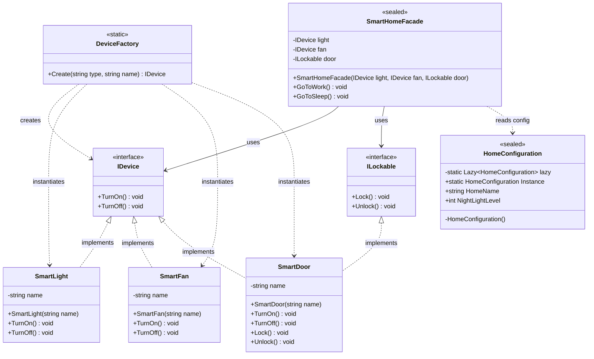

# Báo Cáo Thực Hành 10: Smart Home Mini

- **Học phần**: Thiết kế và Mẫu kiến trúc phần mềm
- **Sinh viên thực hiện**: Sinh viên năm 2 chuyên ngành IT / Kỹ thuật phần mềm
- **Chủ đề**: Xây dựng ứng dụng điều khiển nhà thông minh đơn giản (Smart Home Mini) sử dụng các mẫu thiết kế (Design Patterns).

---

## 1. Sơ đồ lớp (Class Diagram)

---

## 2. Vị trí sử dụng & Lợi ích của các Pattern

### 2.1. Factory Pattern (Lớp `DeviceFactory`)
- **Vị trí sử dụng**: Được đặt tại lớp tĩnh `DeviceFactory` với phương thức `Create(string type, string name)`. Client khi cần tạo bất kỳ thiết bị nào (đèn, quạt, cửa) chỉ cần gọi hàm này mà không gọi trực tiếp `new SmartLight()`, `new SmartFan()`, `new SmartDoor()`.
- **Lợi ích đạt được**:
  - Giảm sự phụ thuộc (Loose Coupling): Client chỉ cần biết abstraction `IDevice`, không cần quan tâm lớp cụ thể nào được tạo ra hay constructor của nó đòi hỏi tham số gì.
  - Gom logic kiểm tra chuỗi (chuẩn hóa chữ hoa/chữ thường, cắt khoảng trắng) và bắt lỗi thiết bị không hợp lệ (`ArgumentException`) vào đúng một chỗ duy nhất.

### 2.2. Singleton Pattern (Lớp `HomeConfiguration`)
- **Vị trí sử dụng**: Áp dụng trong lớp `HomeConfiguration`, sử dụng biến tĩnh `Lazy<HomeConfiguration>` và private constructor để đảm bảo chỉ có duy nhất 1 thể hiện trong toàn bộ chương trình, truy cập qua `HomeConfiguration.Instance`.
- **Lợi ích đạt được**:
  - Đảm bảo tính nhất quán của dữ liệu cấu hình: Cả hệ thống (bao gồm các thiết bị và Facade) đều đọc và chia sẻ chung một cấu hình duy nhất (`HomeName`, `NightLightLevel`), không sợ mỗi nơi tạo một bản copy riêng làm lệch số liệu.
  - Khởi tạo lười (Lazy initialization) và an toàn luồng (Thread-safe) nhờ `Lazy<T>` của .NET.

### 2.3. Facade Pattern (Lớp `SmartHomeFacade`)
- **Vị trí sử dụng**: Được cài đặt trong lớp `SmartHomeFacade`, đóng vai trò là "mặt tiền" cung cấp 2 phương thức mức cao: `GoToWork()` (Đi làm) và `GoToSleep()` (Đi ngủ).
- **Lợi ích đạt được**:
  - Đơn giản hóa tương tác cho Client: Người dùng chỉ cần gọi 1 hàm duy nhất là hệ thống tự động điều khiển một loạt thiết bị tương ứng (ví dụ đi ngủ thì tự tắt quạt, khóa cửa, bật đèn ngủ, hiển thị mức sáng).
  - Client không cần ghi nhớ thứ tự các bước hoặc chi tiết từng phương thức của từng thiết bị con.

---

## 3. Một hạn chế của thiết kế hiện tại

- **Vi phạm Open/Closed Principle (OCP) ở Factory**: Khi muốn bổ sung một loại thiết bị mới (ví dụ `SmartCamera`), ta bắt buộc phải sửa đổi trực tiếp vào thân hàm `Create` của `DeviceFactory` (thêm một nhánh case mới). Nếu sau này có 20-30 loại thiết bị thì mã nguồn của Factory sẽ phình to và rất dễ gây lỗi hồi quy cho các thiết bị cũ.
- **Sự phụ thuộc toàn cục của Singleton**: Việc `SmartHomeFacade` gọi trực tiếp `HomeConfiguration.Instance` bên trong phương thức `GoToSleep()` tạo ra phụ thuộc cứng (tight coupling) vào một trạng thái toàn cục, khiến cho việc viết Unit Test cô lập (Mocking) trở nên khó khăn.

---

## 4. Bảng kết quả kiểm thử (Theo Phần F)

| Mã | Tình huống kiểm tra | Kết quả mong đợi | Kết quả thực tế | Đánh giá |
|:---|:-------------------|:-----------------|:----------------|:--------:|
| **T1** | Tạo `light`, `fan`, `door` qua Factory | Factory trả đúng kiểu đối tượng (`SmartLight`, `SmartFan`, `SmartDoor`) | Trả về đúng các đối tượng thực thi `IDevice` | **PASS** |
| **T2** | Tạo loại `camera` khi chưa hỗ trợ | Phát sinh ngoại lệ `ArgumentException` | Bắt được `ArgumentException: Unsupported device type: camera` | **PASS** |
| **T3** | Lấy `HomeConfiguration.Instance` hai lần | Hai biến cùng tham chiếu một đối tượng duy nhất | `ReferenceEquals(config1, config2)` trả về `True` | **PASS** |
| **T4** | Gọi `GoToWork()` | Đèn tắt, quạt tắt, cửa khóa | In đúng: Đèn OFF, Quạt OFF, Cửa LOCKED | **PASS** |
| **T5** | Gọi `GoToSleep()` | Quạt tắt, cửa khóa, đèn bật, hiện mức sáng | In đúng: Quạt OFF, Cửa LOCKED, Đèn ON, Night light level: 30% | **PASS** |

---

## 5. Trả lời các câu hỏi phân tích (Phần G)

### Câu 1: Factory đang che giấu quyết định thiết kế nào đối với client?
**Trả lời:**
Factory đang che giấu quyết định khởi tạo lớp cụ thể (Concrete Class instantiation). Client hoàn toàn không biết đằng sau lớp nào đang được `new` (`SmartLight`, `SmartFan` hay `SmartDoor`), không cần biết logic khởi tạo ra sao và các phụ thuộc của nó. Client chỉ gửi vào một yêu cầu dạng chuỗi ("light", "fan", "door") và nhận lại một abstraction chung là `IDevice`.

### Câu 2: Singleton bảo đảm điều gì, nhưng tạo ra rủi ro nào?
**Trả lời:**
- **Bảo đảm:** Đảm bảo một lớp chỉ có duy nhất một thể hiện (instance) tồn tại trong suốt vòng đời của ứng dụng và cung cấp một điểm truy cập toàn cục tới thể hiện đó.
- **Rủi ro:** 
  1. Tạo ra biến toàn cục (Global State) ẩn, khiến các module phụ thuộc ngầm vào nhau.
  2. Gây khó khăn lớn cho Unit Testing vì khó mock hoặc reset trạng thái giữa các test case độc lập.
  3. Dễ bị lạm dụng để nhồi nhét quá nhiều trách nhiệm (God Object).

### Câu 3: Facade khác Factory ở mục đích chính như thế nào?
**Trả lời:**
- **Factory (Nhóm Creational - Khởi tạo):** Mục đích chính là giải quyết bài toán *tạo ra đối tượng*. Nó che giấu cách thức khởi tạo và trả về đối tượng thông qua một interface chung.
- **Facade (Nhóm Structural - Cấu trúc):** Mục đích chính là cung cấp một *giao diện cấp cao đơn giản* cho một tập hợp các đối tượng hoặc cả một hệ thống con (subsystem) phức tạp sẵn có, giúp client dễ sử dụng hơn mà không cần phải nắm rõ từng đối tượng con bên trong.

### Câu 4: Nếu bỏ SmartHomeFacade, client sẽ phải biết thêm những chi tiết nào?
**Trả lời:**
Nếu không có Facade, client sẽ phải tự quản lý toàn bộ chi tiết nghiệp vụ:
1. Phải biết hệ thống gồm những thiết bị con nào (`light`, `fan`, `door`) và giữ tham chiếu đến từng thiết bị.
2. Phải biết rõ quy trình và thứ tự thực hiện cho từng kịch bản (ví dụ muốn "Đi ngủ", client phải tự nhớ: gọi `fan.TurnOff()`, gọi `door.Lock()`, gọi `light.TurnOn()`, rồi tự truy cập `HomeConfiguration.Instance` để lấy `NightLightLevel` và in ra).
3. Nếu sau này quy trình "Đi làm" hoặc "Đi ngủ" thay đổi (ví dụ: thêm bước tắt điều hòa hoặc bật chuông chống trộm), toàn bộ mã nguồn của client ở khắp mọi nơi sẽ bị ảnh hưởng và phải sửa lại đồng loạt.
